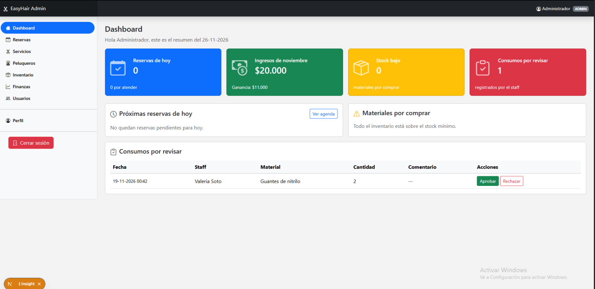
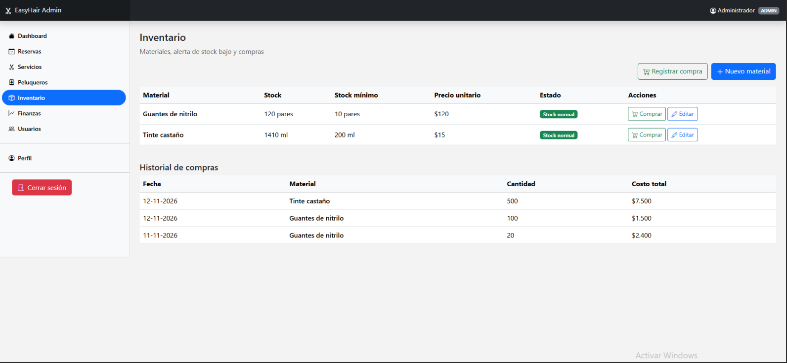
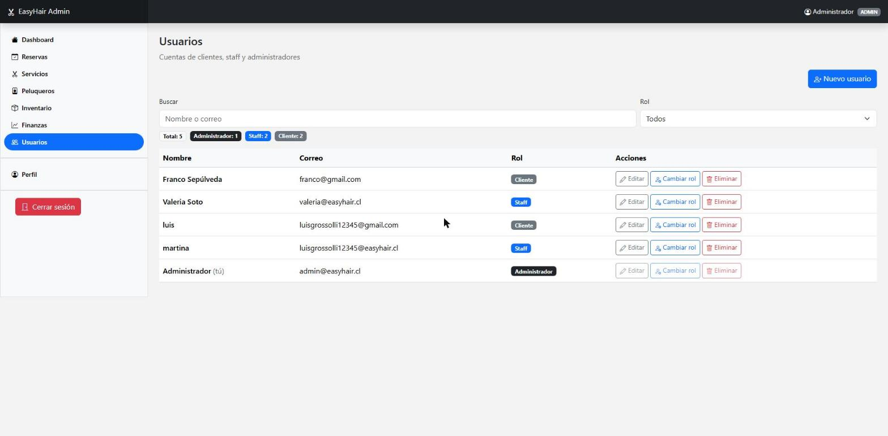
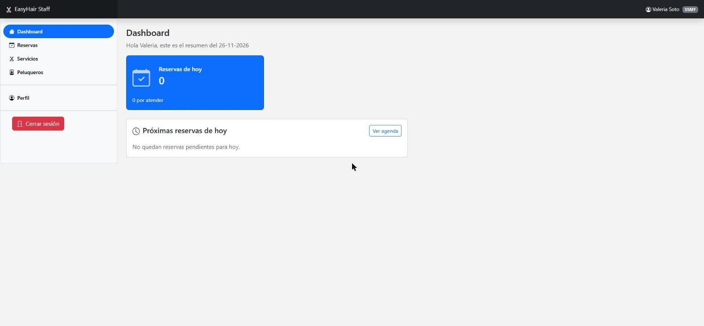

# Manual de usuario – EasyHair Admin

Panel web para administrar la peluquería: reservas, servicios, peluqueros, inventario y finanzas.

## Índice

1. [Pantalla de inicio de sesión](#1-login)
2. [Dashboard](#2-dashboard)
3. [Reservas](#3-reservas)
4. [Servicios](#4-servicios)
5. [Peluqueros](#5-peluqueros)
6. [Inventario](#6-inventario)
7. [Finanzas](#7-finanzas)
8. [Perfil](#8-perfil)
9. [Usuarios](#9-usuarios)
10. [Qué ve cada rol](#10-qué-ve-cada-rol)

## Antes de empezar

- Abre el panel en el navegador (en desarrollo: http://localhost:3000).
- Pueden entrar las cuentas con rol **ADMIN** y **STAFF**. Las cuentas **CLIENTE** solo usan la app móvil.
- El menú lateral izquierdo lleva a cada pantalla. Abajo está el botón para cerrar sesión.
- Si tu sesión vence, el panel te devuelve al login.

---

## 1. Pantalla de inicio de sesión

Escribe tu correo y tu contraseña y pulsa el botón de ingresar. Las cuentas de cliente no pueden entrar al panel: deben usar la app de EasyHair.

<figure>
  
  <figcaption><b>Figura 1.</b> Pantalla de inicio de sesión.</figcaption>
</figure>

**Nota:** Si el correo o la contraseña están mal, aparece un aviso en rojo. La sesión dura 24 horas y se renueva sola mientras usas el panel.

---

## 2. Dashboard

Muestra cuatro tarjetas: Reservas de hoy, Ingresos del mes, Stock bajo y Consumos por revisar. La vista completa está disponible solo para administradores.

<figure>
  
  <figcaption><b>Figura 2.</b> Dashboard.</figcaption>
</figure>

**Nota:** Desde la tabla Consumos por revisar puedes aprobar o rechazar los materiales que el staff registró desde la app. El staff solo ve la tarjeta Reservas de hoy y sus próximas reservas.

---

## 3. Reservas

Agenda del día con los estados de las reservas y los bloqueos de horario. Cada reserva tiene acciones como atender, marcar que el cliente no asistió, cancelar y reprogramar.

<figure>
  
  <figcaption><b>Figura 3.</b> Reservas.</figcaption>
</figure>

**Nota:** Una reserva solo se puede atender el mismo día. Para cancelar hay que escribir un motivo, y al reprogramar solo se ofrecen las horas libres. Las horas bloqueadas no se pueden reservar desde la app.

---

## 4. Servicios

Lista de servicios con su duración y precio. Usa el botón azul para crear uno nuevo; cada fila permite editar o eliminar.

<figure>
  
  <figcaption><b>Figura 4.</b> Servicios.</figcaption>
</figure>

**Nota:** Antes de eliminar un servicio se pide confirmación. Un servicio eliminado deja de aparecer en la app, pero las reservas anteriores se mantienen. El staff solo puede ver la lista.

---

## 5. Peluqueros

Equipo de la peluquería y su correo de acceso. Usa el botón azul para agregar un peluquero.

<figure>
  
  <figcaption><b>Figura 5.</b> Peluqueros.</figcaption>
</figure>

**Nota:** El correo del peluquero debe ser el mismo de su cuenta Staff: así la app le muestra su agenda. El staff solo puede ver la lista.

---

## 6. Inventario

Materiales con su stock actual y mínimo, alerta de stock bajo e historial de compras. Los botones permiten registrar una compra o crear un material. Disponible solo para administradores.

<figure>
  
  <figcaption><b>Figura 6.</b> Inventario.</figcaption>
</figure>

**Nota:** Al registrar una compra, el stock del material sube solo y el gasto queda anotado como egreso en Finanzas.

---

## 7. Finanzas

Ingresos, egresos y ganancia por mes. Elige el mes arriba y registra movimientos con el botón azul. Disponible solo para administradores.

<figure>
  
  <figcaption><b>Figura 7.</b> Finanzas.</figcaption>
</figure>

**Nota:** Cada reserva atendida se registra sola como ingreso, y cada compra de materiales como egreso. Eliminar un movimiento no se puede deshacer.

---

## 8. Perfil

Datos de tu cuenta. Puedes cambiar tu nombre y, si quieres, tu contraseña (hay que confirmarla dos veces).

<figure>
  
  <figcaption><b>Figura 8.</b> Perfil.</figcaption>
</figure>

**Nota:** El rol no se puede cambiar desde aquí; lo cambia un administrador en Usuarios. Si eres staff, no cambies tu correo, porque es el que te une con tu agenda de peluquero.

---

## 9. Usuarios

Lista de todas las cuentas (clientes, staff y administradores) con un buscador por nombre o correo y un filtro por rol. Arriba se ve cuántas cuentas hay de cada rol. Disponible solo para administradores.

- **Nuevo usuario:** crea una cuenta con nombre, correo, contraseña y rol.
- **Editar:** cambia el nombre, el correo o la contraseña (si la contraseña queda vacía, no se cambia).
- **Cambiar rol:** por ejemplo, pasar un cliente a staff.
- **Eliminar:** borra la cuenta después de confirmar.

<figure>
  
  <figcaption><b>Figura 9.</b> Usuarios.</figcaption>
</figure>

**Nota:** Tu propia cuenta aparece marcada con "(tú)" y no se puede editar, cambiar de rol ni eliminar desde aquí, para que el panel nunca quede sin administrador. Tus datos se cambian en Perfil. Si creas una cuenta Staff, crea también el peluquero con el mismo correo.

---

## 10. Qué ve cada rol

El menú y los botones cambian según el rol de la cuenta. Arriba a la izquierda dice "EasyHair Admin" o "EasyHair Staff".

| Sección | Administrador | Staff |
|---|---|---|
| Dashboard | Completo | Solo reservas de hoy |
| Reservas | Sí | Sí |
| Servicios | Ver, crear, editar y eliminar | Solo ver |
| Peluqueros | Ver, crear y editar | Solo ver |
| Inventario | Sí | No |
| Finanzas | Sí | No |
| Usuarios | Sí | No |
| Perfil | Sí | Sí |

Las cuentas Cliente no pueden entrar al panel: usan la app móvil.

<figure>
  
  <figcaption><b>Figura 10.</b> Dashboard visto por una cuenta Staff.</figcaption>
</figure>

**Nota:** Si una cuenta Staff escribe a mano la dirección de una sección que no le corresponde (por ejemplo /finanzas), aparece la página "Sin permisos" con un botón para volver al inicio.
