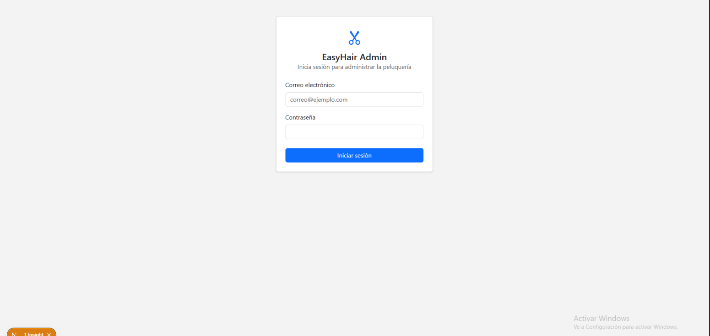
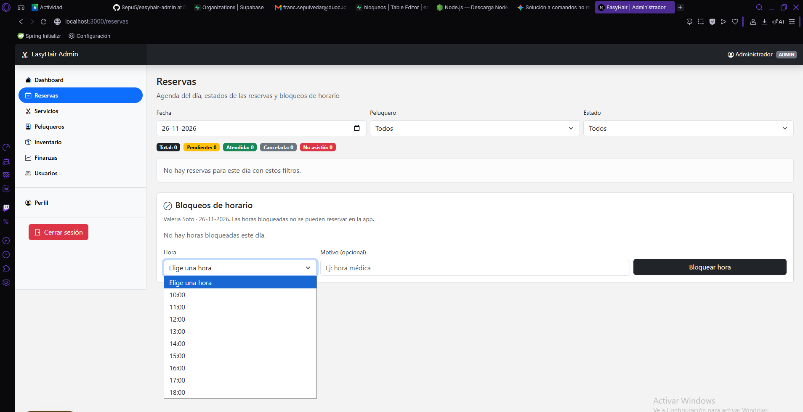
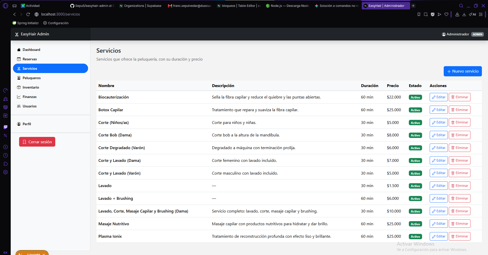
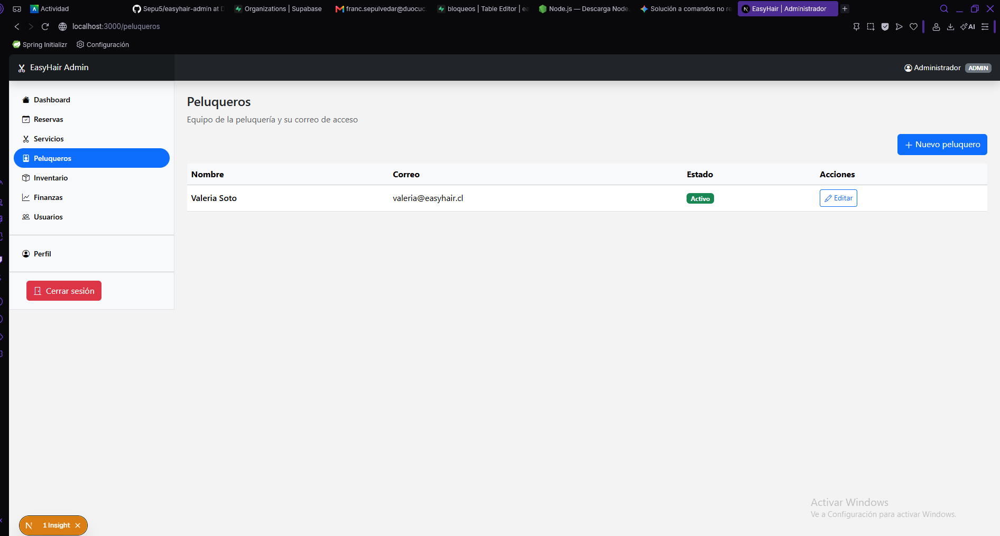
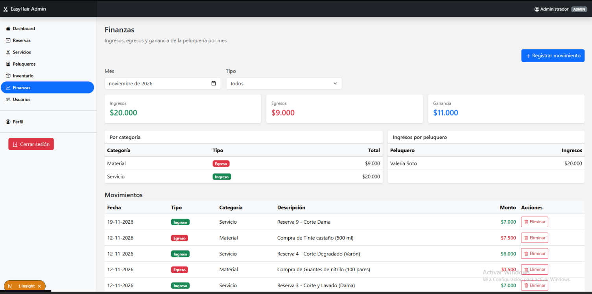
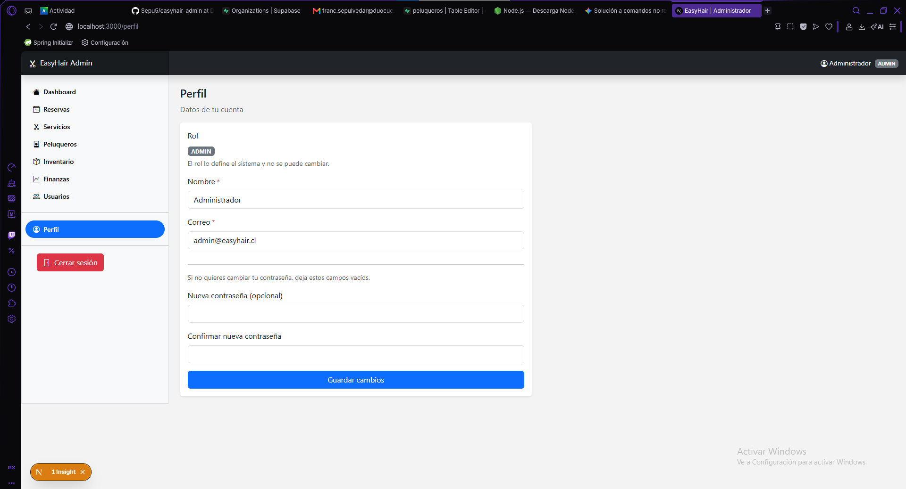

# Manual de usuario – EasyHair Admin

Panel web para administrar la peluquería: reservas, servicios, peluqueros, inventario y finanzas.

## Índice

1. [Pantalla de inicio de sesión](#1-login)
2. [Dashboard](#2-dashboard)
3. [Reservas](#3-reservas)
4. [Servicios](#4-servicios)
5. [Peluqueros](#5-peluqueros)
6. [Inventario](#6-inventario)
7. [Finanzas](#7-finanzas)
8. [Perfil](#8-perfil)
9. [Usuarios](#9-usuarios)
10. [Qué ve cada rol](#10-qué-ve-cada-rol)

## Antes de empezar

- Abre el panel en el navegador (en desarrollo: http://localhost:3000).
- Pueden entrar las cuentas con rol **ADMIN** y **STAFF**. Las cuentas **CLIENTE** solo usan la app móvil.
- El menú lateral izquierdo lleva a cada pantalla. Abajo está el botón para cerrar sesión.
- Si tu sesión vence, el panel te devuelve al login.

---

## 1. Pantalla de inicio de sesión

Escribe tu correo y tu contraseña y pulsa el botón de ingresar. Las cuentas de cliente no pueden entrar al panel: deben usar la app de EasyHair.

<figure>
  
  <figcaption><b>Figura 1.</b> Pantalla de inicio de sesión.</figcaption>
</figure>

**Nota:** Escribe tu correo y tu contraseña y pulsa el botón de ingresar. Las cuentas de cliente no pueden entrar al panel: deben usar la app de EasyHair.

---

## 2. Dashboard

Muestra cuatro tarjetas: Reservas de hoy, Ingresos del mes, Stock bajo y Consumos por revisar. Entra con la cuenta ADMIN para ver esta pantalla completa.

<figure>
  
  <figcaption><b>Figura 2.</b> Dashboard.</figcaption>
</figure>

**Nota:** Muestra cuatro tarjetas: Reservas de hoy, Ingresos del mes, Stock bajo y Consumos por revisar. Entra con la cuenta ADMIN para ver esta pantalla completa.

---

## 3. Reservas

Agenda del día con los estados de las reservas y los bloqueos de horario. Cada reserva tiene acciones como atender, marcar que el cliente no asistió, cancelar y reprogramar.

<figure>
  
  <figcaption><b>Figura 3.</b> Reservas.</figcaption>
</figure>

**Nota:** Agenda del día con los estados de las reservas y los bloqueos de horario. Cada reserva tiene acciones como atender, marcar que el cliente no asistió, cancelar y reprogramar.

---

## 4. Servicios

Lista de servicios con su duración y precio. Usa el botón azul para crear uno nuevo; cada fila permite editar o eliminar.

<figure>
  
  <figcaption><b>Figura 4.</b> Servicios.</figcaption>
</figure>

**Nota:** Lista de servicios con su duración y precio. Usa el botón azul para crear uno nuevo; cada fila permite editar o eliminar.

---

## 5. Peluqueros

Equipo de la peluquería y su correo de acceso. Usa el botón azul para agregar un peluquero.

<figure>
  
  <figcaption><b>Figura 5.</b> Peluqueros.</figcaption>
</figure>

**Nota:** Equipo de la peluquería y su correo de acceso. Usa el botón azul para agregar un peluquero.

---

## 6. Inventario

Materiales con su stock actual y mínimo, alerta de stock bajo e historial de compras. Los botones permiten registrar una compra o crear un material. Entra con la cuenta ADMIN.

<figure>
  
  <figcaption><b>Figura 6.</b> Inventario.</figcaption>
</figure>

**Nota:** Materiales con su stock actual y mínimo, alerta de stock bajo e historial de compras. Los botones permiten registrar una compra o crear un material. Entra con la cuenta ADMIN.

---

## 7. Finanzas

Ingresos, egresos y ganancia por mes. Elige el mes arriba y registra movimientos con el botón azul. Entra con la cuenta ADMIN.

<figure>
  
  <figcaption><b>Figura 7.</b> Finanzas.</figcaption>
</figure>

**Nota:** Ingresos, egresos y ganancia por mes. Elige el mes arriba y registra movimientos con el botón azul. Entra con la cuenta ADMIN.

---

## 8. Perfil

Datos de tu cuenta. Puedes cambiar tu nombre y, si quieres, tu contraseña (hay que confirmarla dos veces).

<figure>
  
  <figcaption><b>Figura 8.</b> Perfil.</figcaption>
</figure>

**Nota:** Datos de tu cuenta. Puedes cambiar tu nombre y, si quieres, tu contraseña (hay que confirmarla dos veces).

---

## 9. Usuarios

> Pendiente. Esta sección se completará cuando la pantalla Usuarios esté terminada.

---

## 10. Qué ve cada rol

> Pendiente. Se completará cuando termine el trabajo de Usuarios y permisos por rol.
